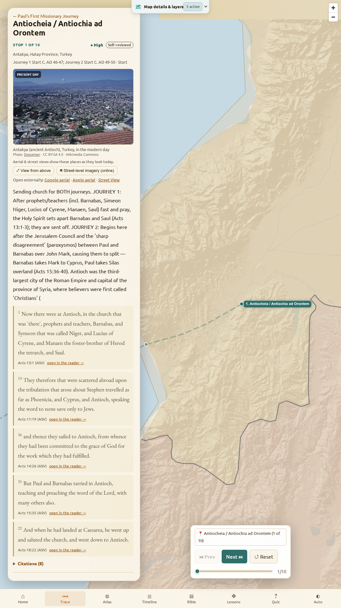
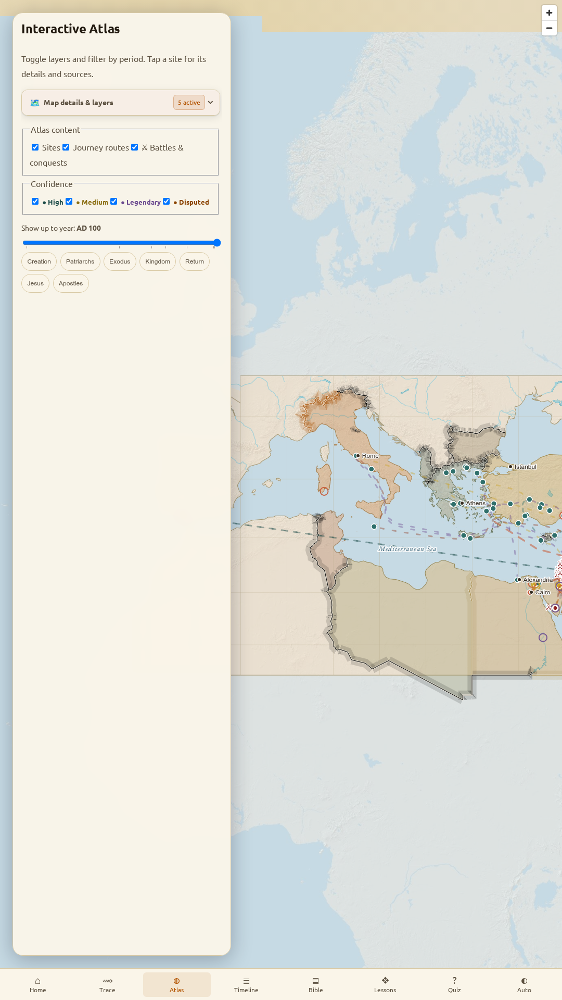
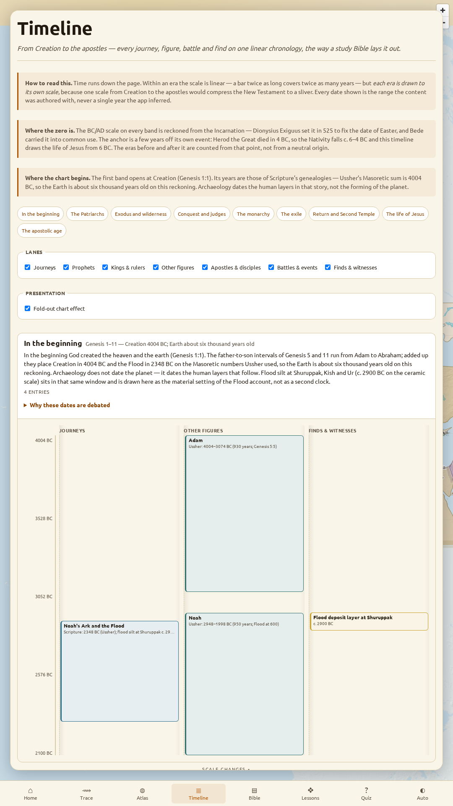
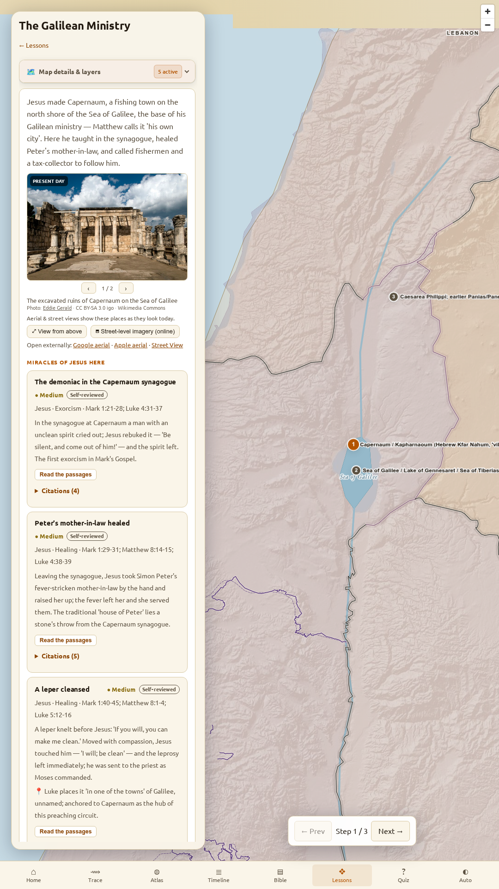
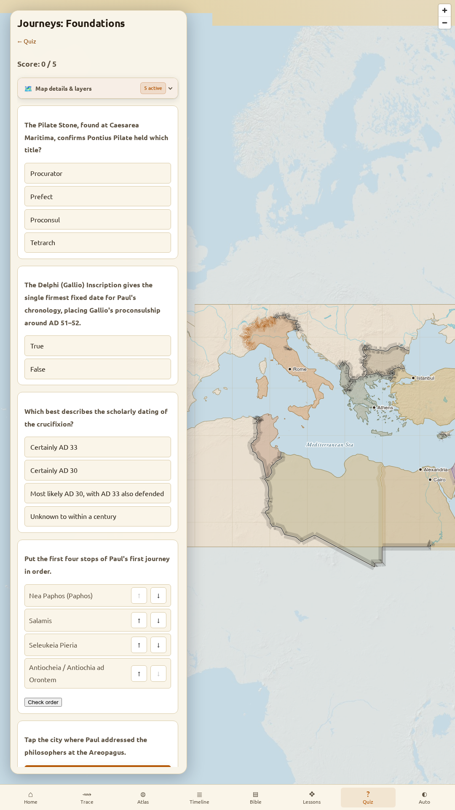

<p align="center">
  
</p>

# Journeys

<p align="center">
  <strong>An accurate, cited, offline atlas of the biblical historical record.</strong><br />
  From Creation through the patriarchs, the exodus, the kings and prophets, the battles of the Old Testament, the birth and ministry of Jesus, and the travels of the apostles.
</p>

<p align="center">
  <a href="https://github.com/SeanLebida/journeys/releases"></a>
  <a href="LICENSE"></a>
  
  
  
  
</p>

---

## Overview

**Journeys** is an accurate, cited, offline atlas of the historical record in the Bible. It bridges Scripture, ancient geography, and archaeology with a denominationally neutral stance.

One TypeScript codebase ships three ways:
- **Web** — static client-side PWA, instant loading, no API keys
- **iOS** — native app packaged via Capacitor with TestFlight distribution
- **Android** — native app packaged via Capacitor for the Google Play Store

### By the Numbers

- **132** archaeological & historical sites mapped across the Mediterranean and Near East
- **18** interactive journeys tracing routes from Abraham to Paul and Peter
- **154** stop-by-stop accounts with historical notices and scripture references
- **9** historical travel corridors (Roman surveyed roads, trade routes, sea lanes)
- **89** dated historical figures (prophets, judges, kings of Israel & Judah, foreign rulers, apostles)
- **60** miracle accounts (all 37 recorded miracles of Jesus + apostolic miracles in Acts)
- **38** Old Testament battles & conquests synchronized with ancient Near Eastern records
- **30** archaeological finds & **9** extra-biblical witnesses
- **1,164** academic citations — **no claim rests on Wikipedia alone**
- **10 MB** bundled on-device SQLite Scripture database (complete KJV and ASV, 62,000+ verses)

---

## Six Ways to Explore

<table width="100%">
  <tr>
    <td width="50%" valign="top">
      <h3>1. ⟿ Route Tracing</h3>
      <p>Follow animated journeys on the ancient map. Trace the patriarchs, the exodus, the conquest, the non-writing prophets, the Galilean and Judean ministry of Jesus, and Paul’s missionary journeys to Rome. Every leg distinguishes between surveyed Roman roads, reconstructed overland corridors, and ancient sea lanes.</p>
      
    </td>
    <td width="50%" valign="top">
      <h3>2. ◍ Sandbox Atlas</h3>
      <p>Freely explore historical layers across the ancient world. Toggle Roman roads, trade lanes, provincial borders, Iron Age kingdoms, and modern geographical reference points. Tap any site to view archaeological notes, excavators, artifact records, and street-level views.</p>
      
    </td>
  </tr>
  <tr>
    <td width="50%" valign="top">
      <h3>3. ≣ Biblical Chronology & Fold-Out Chart</h3>
      <p>One unified chronology spanning Creation through the apostolic age. Each era has its own proportional scale so Passion week is not flattened against three millennia. Parallel swimlanes chart who lived concurrently: patriarchs, prophets, kings of Israel and Judah, Roman emperors, battles, and archaeological finds.</p>
      
    </td>
    <td width="50%" valign="top">
      <h3>4. ▤ Embedded Bible Reader</h3>
      <p>Read Scripture side-by-side with the map. Bundles complete public-domain texts (King James Version and American Standard Version) in an on-device SQLite database. Tap place names in Scripture to jump straight to the atlas. Highlights and private notes persist locally and export as Markdown.</p>
      
    </td>
  </tr>
  <tr>
    <td width="50%" valign="top">
      <h3>5. ❖ Guided Lessons</h3>
      <p>Take paced, step-by-step deep dives into pivotal biblical events. Examine historical backgrounds, topographic realities, and archaeological artifacts with synchronized map camera movements.</p>
      
    </td>
    <td width="50%" valign="top">
      <h3>6. ? Interactive Quizzes</h3>
      <p>Test and reinforce your knowledge of ancient geography, apostolic travels, and historical backgrounds through multiple-choice questions, chronological ordering, and map-pin challenges.</p>
      
    </td>
  </tr>
</table>

---

## Scholarly Rigor & Accuracy Principles

Journeys is built upon strict accuracy principles enforced mechanically at compile time:

- **Concrete Scholarly Sources**: Tertiary sources (Wikipedia, devotional websites, popular encyclopedias) serve solely as orienting links. Every cited claim is backed by a primary text (Scripture, ANET, Josephus, Tacitus, cuneiform annals, Roman itineraries), an excavation report, or an academic gazetteer (Pleiades, DARE, Aharoni, the Sacred Bridge atlas). `npm run build:content` **fails CI** if any claim rests on tertiary sources alone.
- **Four Confidence Tiers**:
  - `high` — Securely identified and physically or epigraphically attested.
  - `medium` — Traditional or topographically apt, not definitively proven.
  - `disputed` — Scholars actively disagree on location or identification.
  - `legendary` — Preserved in later church or local tradition without early archaeological or textual support.
- **Ambiguity Shown, Not Hidden**: When scholars disagree on a site location, Journeys displays all documented rival candidates as hollow markers on the map rather than presenting a single guesswork pin.
- **Graded Route Strokes**: Geometry is classified as `surveyed-road` (snapped to published Roman road surveys), `reconstructed-land` (historically argued corridor), `sea-lane` (sail route reconstructed from ancient notices), or `schematic` (connector).
- **Visible Review Status**: Every claim clearly displays its status: `draft`, `self-reviewed`, or `scholar-approved`. The release build gate (`npm run build:content -- --release`) intentionally blocks production store releases until qualified historical geographers sign off on high-confidence claims.
- **Scholarly Date Ranges**: Dates are presented as historical ranges, avoiding artificial single-year precision where ancient calendars and records differ.

---

## 100% Offline & Privacy First

Journeys was engineered to work reliably in sanctuaries, classrooms, remote archaeological sites, and on airplanes:

- **Complete On-Device Database**: A 10 MB SQLite database containing the full text of the KJV and ASV is bundled into the client via WebAssembly (`sql.js`).
- **Offline Vector Map**: Basemap vector tiles and GeoJSON boundaries are packaged locally; no external tile servers are pinged during normal exploration.
- **Zero Telemetry**: No analytics, no tracking, no third-party ad networks, no cookies, and no network phone-home.
- **Zero Accounts**: No sign-in or account creation required. All reading notes and preferences remain strictly on your device.

---

## Tech Stack

| Layer | Technology |
|---|---|
| **Core Framework** | [React 18](https://react.dev/) · [TypeScript 5.7](https://www.typescriptlang.org/) · [Vite 6](https://vitejs.dev/) |
| **State & Routing** | [Zustand 5](https://github.com/pmndrs/zustand) · [React Router 6](https://reactrouter.com/) |
| **Mapping Engine** | [MapLibre GL JS 4.7](https://maplibre.org/) · [Turf.js](https://turfjs.org/) · PMTiles |
| **Local Database** | [sql.js](https://sql.js.org/) (SQLite compiled to WebAssembly) |
| **Mobile Runtime** | [Capacitor 6](https://capacitorjs.com/) (iOS & Android) |
| **Internationalization** | [react-i18next](https://react.i18next.com/) |
| **Content Modeling** | [Zod](https://zod.dev/) (schemas emit TypeScript types + JSON Schema) |
| **Testing & Quality** | [Vitest](https://vitest.dev/) (120 unit tests) · [Playwright](https://playwright.dev/) (E2E) · ESLint |

---

## Development

### Prerequisites

- **Node.js** >= 20.0.0
- **npm** >= 10.0.0

### Local Setup

```bash
# Clone the repository
git clone https://github.com/SeanLebida/journeys.git
cd journeys

# Install dependencies
npm install

# Start Vite development server
npm run dev
```

### Verification & Builds

```bash
# Typecheck TypeScript without emitting
npm run typecheck

# Lint codebase with ESLint
npm run lint

# Run Vitest test suite (unit + content integrity + component tests)
npm test

# Compile & validate content against accuracy gate
npm run build:content

# Full production web build
npm run build

# End-to-end tests via Playwright
npm run test:e2e
```

### Native Mobile Builds (iOS & Android)

Native platforms are synced from the production web bundle:

```bash
# Build web assets and sync to native containers
npm run build
npm run cap:sync

# iOS (Xcode required)
npx cap open ios

# Android (Android Studio required)
npx cap open android
```

---

## Repository Layout

```
journeys/
├── content/              # Authored JSON datasets (journeys, sites, persons, artifacts, citations)
├── dist-content/         # Compiled SQLite database (content.sqlite) & bundle.json
├── docs/                 # App Store and Google Play listing documentation & checklists
│   └── store-assets/     # High-resolution screenshots, banners, icons, and preview media
├── ios/                  # Capacitor iOS native Xcode project & configuration
├── android/              # Capacitor Android native Gradle project & configuration
├── learnings/            # Architectural decisions, retrospectives, and session records
├── scripts/              # build-content.ts accuracy gate & asset generation tools
├── src/
│   ├── components/       # UI views (HomeView, CreditsView/AboutView, TabBar, SiteViews)
│   ├── content/          # Zod schemas, SQLite hooks, timeline models, scripture indexing
│   ├── i18n/             # Translations (en.json) & localization configuration
│   ├── map/              # MapLibre GL layer management, trace animation, basemap layers
│   ├── modes/            # Mode screens (TraceMode, AtlasMode, TimelineMode, BibleMode, LessonMode, QuizMode)
│   ├── platform/         # Unified native/web seam (bridge, storage, external URLs)
│   ├── state/            # Zustand stores (journey, map layers, notes, ui, quiz)
│   └── styles/           # CSS design system (tokens, fonts, global stylesheet)
└── tests/                # Unit test suites & Playwright E2E integration specs
```

---

## Project Status & Milestones

The project has achieved milestones **M0–M9** in release **v0.3.14**:

- **M0** — Project scaffold, platform abstraction seam, Zustand state, i18n, CI pipelines
- **M1** — Persistent offline MapLibre GL map engine & WCAG accessibility baseline
- **M2** — Zod content model, automated `build-content` accuracy gate, and bundled SQLite Bible (KJV + ASV)
- **M3** — Animated route tracing with graded travel paths
- **M4** — Interactive sandbox atlas with toggleable historical layers
- **M5** — Guided educational lessons with automated map choreography
- **M6** — Interactive quiz engine with map-pin scoring
- **M7** — Offline PWA service worker precaching full app shell, WASM, and 10 MB Bible DB
- **M8** — Over-the-air (OTA) content update channels & apostolic traditions
- **M9** — App Store & Play Store release packets, metadata, icon sets, and review verification

---

## Data & Software Attributions

- **MapLibre GL JS**: BSD-3-Clause license.
- **Ancient Geodata**: Pleiades, Ancient World Mapping Center (AWMC), and ORBIS under open redistribution licenses.
- **Scripture Texts**: Public-domain translations (King James Version, American Standard Version).
- **Typography**: Ubuntu Font Family (Ubuntu Font Licence 1.0) and EB Garamond (SIL Open Font Licence 1.1).

---

## License

This project is licensed under the [MIT License](LICENSE).
